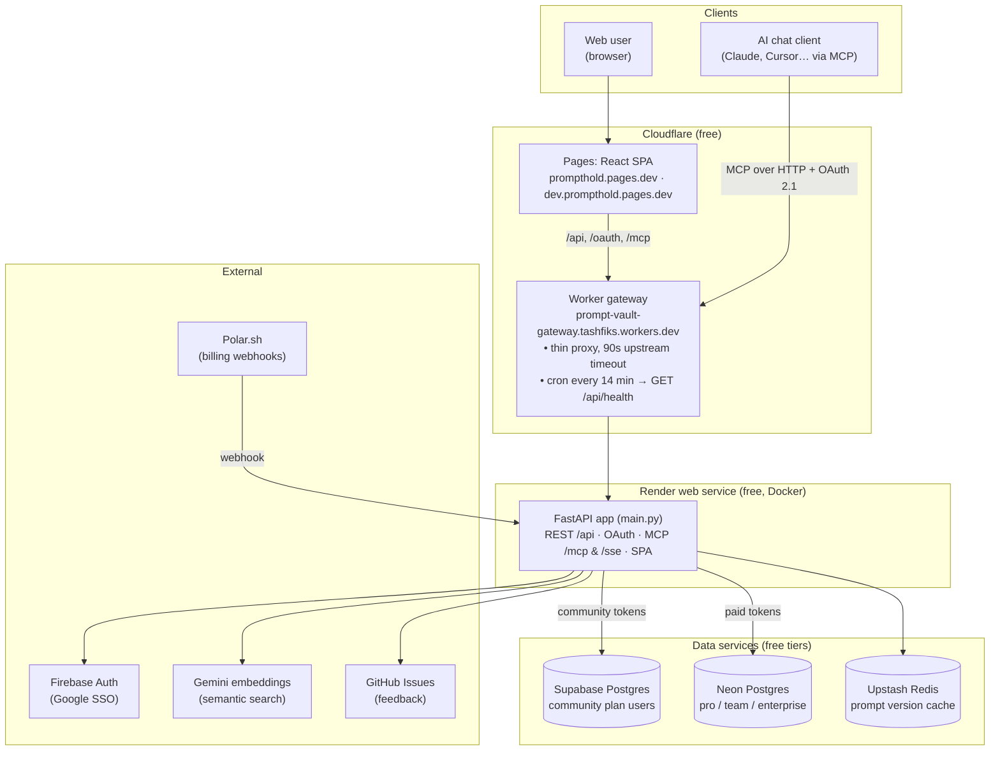
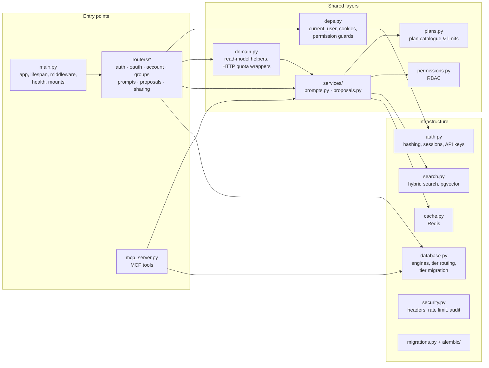
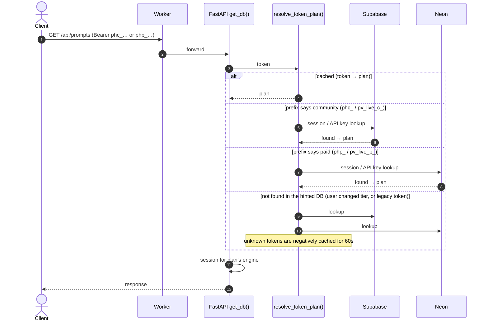
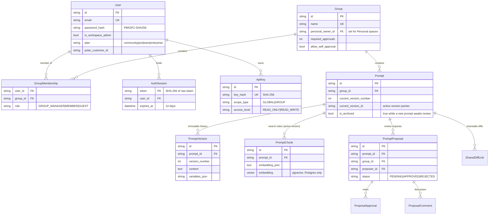

# PromptFolders: System Architecture

How PromptFolders is put together: the hosted services, how a request reaches the right database, how the backend code is layered, the data model, and the operating rules that keep everything on free tiers.

For rules an agent or contributor must follow when changing behaviour, see [`AGENTS.md`](AGENTS.md). For deploy steps, see [`DEPLOYMENT_GUIDE.md`](DEPLOYMENT_GUIDE.md) and [`MAKING_CHANGES_LIVE.md`](MAKING_CHANGES_LIVE.md).

---

## 1. System overview



Key facts:

- **One deployable.** The Render container serves the REST API, the OAuth 2.1 authorization server, the FastMCP server and (when built) the SPA. The same React bundle also runs as the in-chat MCP drawer with `?mcp_mode=1` (`ui://prompt-hold/drawer`).
- **The Worker is only a proxy.** It forwards backend routes, sets `X-Forwarded-Host` so OAuth metadata advertises the public origin, passes the real client IP behind a shared `GATEWAY_SECRET`, and returns a 503 "starting up" if Render does not answer within 90s. It holds no database credentials and does no failover.
- **Two databases by plan.** Free users live in Supabase and paid users in Neon. Neon's free tier is metered by compute time, so community traffic never touches it and Neon can scale to zero. See section 3.
- **One backend for both environments.** `dev.prompthold.pages.dev` and `prompthold.pages.dev` talk to the same Worker and the same Render service and databases. Pushing to `dev` redeploys that shared backend (pipeline job 6), so treat `dev` pushes as production backend deploys.

---

## 2. Backend code layout



| Layer | Owns | Must not |
|---|---|---|
| `routers/*`, `mcp_server.py` | Authentication, group-role checks, audit logging, request/response shapes, mapping errors (`HTTPException` vs `ValueError`) | Re-implement business rules that exist in `services/` |
| `services/prompts.py` | Plan quota, create-or-propose, duplicate, move | Import FastAPI or raise HTTP errors (raises `PromptError` with a `status_code`) |
| `services/proposals.py` | Pending-only rule, self-approval rule, one vote per reviewer, merge into a new version | Same as above (`ProposalError`) |
| `permissions.py` | Who may see or write a group | — |
| `plans.py` | `PLAN_TIERS`, `PLAN_LIMITS_MAP`, `plan_info_for(user)` | Import anything web-related (services depend on it) |

REST and MCP are thin adapters over the same services, so a prompt created from chat follows exactly the same quota and review rules as one created in the web UI.

---

## 3. Request routing across the two databases



- **Tier hints in tokens.** New session tokens start with `phc_` or `php_`, and new API keys with `pv_live_c_` or `pv_live_p_`. The hint is only a first guess. Legacy tokens with no prefix still work: they check Supabase first, then Neon.
- **Routing cache.** It is in process memory (`database._token_plan_cache`) and is safe because Render runs a single instance. Run a second instance and it must move to Redis.
- **Errors are not swallowed.** A database error during routing is logged and the lookup moves on to the next database.

### Tier migration (`database.migrate_user_tier`)

Triggered by Polar webhooks (`polar_billing.py`) and the admin plan endpoint when a user crosses the community ↔ paid boundary:

1. **Select** the user's Personal space plus any team group they created where they are the **only** member. Shared team groups stay in the source tier.
2. **Upsert** the user, groups, memberships, prompts, versions, search chunks, diff links, proposals, approvals, comments, API keys and sessions into the destination, matching rows by primary key. Re-running is safe.
3. **Re-point routing.** Clear the user's cached tokens and point them at the new tier.
4. **Delete** the source copy, children first. If the user still belongs to shared groups in the source tier, a stub user row is kept so foreign keys stay valid.

Any failure raises, so the webhook returns 500 and Polar retries. Because the copy is an upsert, the retry finishes the job. **Any new table that holds user data must be added to this function.**

---

## 4. Data model



Also present: `AuditLog`, `FeedbackSubmission`, `OAuthClient` and `OAuthAuthorizationCode`.

### Schema changes

- **Alembic is the source of truth for new changes.** Add a revision in `backend/alembic/versions/`. `migrations.run_migrations(engine)` runs on startup and in `migrate.py`, once for each tier engine.
- **`auth.upgrade_schema()` is frozen.** It is the pre-Alembic baseline that brings old databases up to revision `0001_baseline`. Don't extend it.
- **Running the CLI.** Run `alembic` from `backend/` with `ALEMBIC_DATABASE_URL` set. `env.py` refuses to fall back to `DATABASE_URL`, because `.env` points at the live Neon database.

### Search

`search.hybrid_search_prompts` fuses two rankings with reciprocal rank fusion:

- **Lexical:** fuzzy scoring over the active versions the user can access.
- **Semantic:** cosine similarity between the query embedding and each prompt's chunks. On Postgres with pgvector this runs in SQL against a dimension-less `vector` column (both 768-d and 3072-d Gemini embeddings work). On SQLite, or without the extension, it falls back to Python.

Only the active version is indexed, so `sync_prompt_embeddings` must run whenever the active version changes.

### Caching

Redis only (Upstash). Each active-version pointer and version snapshot is keyed by UUID. Call `invalidate_prompt_cache(prompt_id)` whenever the active version changes. Every Redis call fails open, so a Redis outage slows requests down but doesn't break them.

---

## 5. Access control

| Capability | Workspace admin | Owner (`GROUP_MANAGER`) | Member | Guest | Personal owner |
|---|:---:|:---:|:---:|:---:|:---:|
| View group prompts and diffs | ✅ | ✅ | ✅ | ✅ | ✅ (own only) |
| Publish a version directly | ✅ | ✅ | ➖ creates proposal | ❌ | ✅ |
| Vote on proposals | ✅ | ✅ | ✅ (own only if self-approval on) | ❌ | — |
| Switch active version | ✅ | ✅ | ❌ | ❌ | ✅ |
| Manage members, required approvals | ✅ | ✅ | ❌ | ❌ | — |
| Duplicate / move prompts | ✅ | ✅ | ✅ | ❌ | ✅ |
| See another user's Personal space | ❌ | ❌ | ❌ | ❌ | — |

API keys narrow this further: `GROUP` scope limits a key to one group, and `READ_ONLY` blocks writes. Every prompt or group query goes through `permissions.py`, and REST and MCP enforce the same checks.

---

## 6. Free-tier operating rules

| Concern | What the code does | Why |
|---|---|---|
| Neon compute hours | `/api/health` pings **only Supabase** by default (`?deep=1` also checks Neon). Community requests never open a Neon session. Startup only backfills missing Personal spaces. | Render's health checker and the Worker cron call `/api/health` constantly; pinging Neon there kept it awake around the clock. |
| Supabase auto-pause | The Worker cron hits `/api/health` every 14 min. `.github/workflows/keep-alive.yml` is a backup that runs every 3 days. | Free Supabase projects pause after about a week with no activity. |
| Render cold starts | The Worker cron keeps the instance warm, and the Worker waits up to 90s before returning 503. | The free instance sleeps after 15 min idle. |
| Connection limits | Pooled URLs (Neon `-pooler` host, Supabase `pooler.supabase.com:6543`) with `prepare_threshold=None`. A startup warning fires if a URL isn't pooled. | Free tiers cap direct connections. |
| Embedding quota | Embeddings are computed only when a version becomes active, and search falls back to lexical. | Gemini free-tier rate limits. |

---

## 7. Frontend modes

`frontend/src/App.tsx` picks a mode from the URL:

- **Shared diff view:** `?share_diff=<id>` shows a read-only side-by-side or inline diff.
- **MCP drawer:** `?mcp_mode=1` gives a compact view inside AI clients. Pick a prompt, fill its `{{variables}}`, and insert it into the chat.
- **Web workspace:** everything else. It covers spaces, the editor with a live variable tester, version timeline and rollback, the review inbox, groups and members, API keys, and uploads.

`frontend/src/types.ts` mirrors `backend/schemas.py`, and `api.ts` holds the client and token storage. The UI guardrail build step rejects native `<select>`, `<datalist>` and `alert`/`confirm`/`prompt`.

---

## 8. Repository map

```text
prompt-vault-mcp/
├── backend/
│   ├── main.py            # App assembly: lifespan, middleware, /api/health, MCP + SPA mounts
│   ├── routers/           # REST routes by domain (auth, oauth, account, groups, prompts, proposals, sharing)
│   ├── services/          # Business rules shared by REST and MCP (prompts.py, proposals.py)
│   ├── deps.py            # current_user / maybe_user, session cookies, permission guards
│   ├── domain.py          # Read-model helpers, HTTP wrappers around service quotas
│   ├── plans.py           # Plan catalogue and limits
│   ├── mcp_server.py      # FastMCP tools (thin adapters over services/)
│   ├── database.py        # Engines, tier routing, migrate_user_tier
│   ├── auth.py            # Password hashing, sessions, API keys, legacy upgrade_schema()
│   ├── migrations.py      # Alembic runner; alembic/ holds revisions
│   ├── permissions.py     # RBAC helpers
│   ├── search.py          # Hybrid search, pgvector
│   ├── cache.py           # Redis cache, GitHub feedback issues
│   ├── oauth.py           # OAuth 2.1 server for MCP clients
│   ├── polar_billing.py   # Checkout, portal, webhooks → tier migration
│   ├── security.py        # Security headers/CSP, rate limiter, uploads, audit log
│   ├── models.py / schemas.py / seed.py / migrate.py
│   └── tests/
├── frontend/              # React 19 + Vite 8 + Tailwind 4 SPA (also the MCP drawer)
├── cloudflare-worker/     # Gateway proxy + 14-min keep-alive cron
├── .github/workflows/     # pipeline.yml (CI/CD), browser-e2e.yml, keep-alive.yml
├── Dockerfile · render.yaml · docker-compose.yml · Makefile · run_tests.sh
└── AGENTS.md · ARCHITECTURE.md · DEPLOYMENT_GUIDE.md · MAKING_CHANGES_LIVE.md · README.md
```

---

## 9. Known limits and next steps

- **Single instance assumed.** The token-routing cache and the MCP session-key map (`mcp_server._session_api_keys`) live in process memory. Before scaling Render beyond one instance, move both to Redis.
- **Shared dev/prod backend.** There is no staging backend or database, so a bad `dev` push affects production users. When budget allows, add a second Render service and Neon branch for `dev`.
- **Webhook retries after migration.** The Polar webhook resolves the user through the community database. If a retry arrives after the user has already moved to Neon, it may not find them. Watch the logs after real upgrades.
- **Lexical search scans in Python.** It still loads every accessible active version. Move it to `pg_trgm` (already enabled on Postgres) if libraries grow to thousands of prompts.
