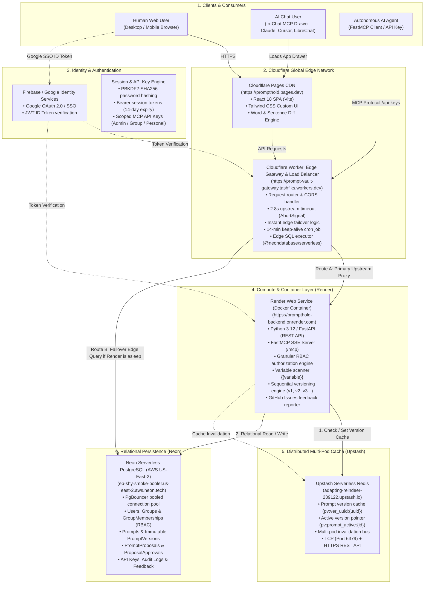
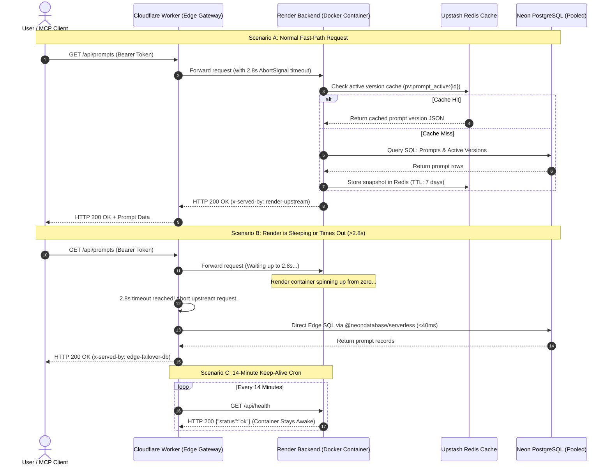
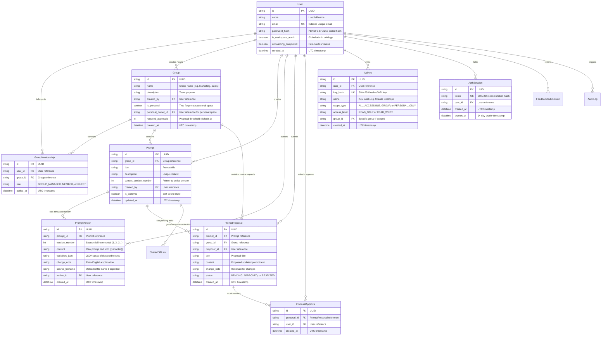
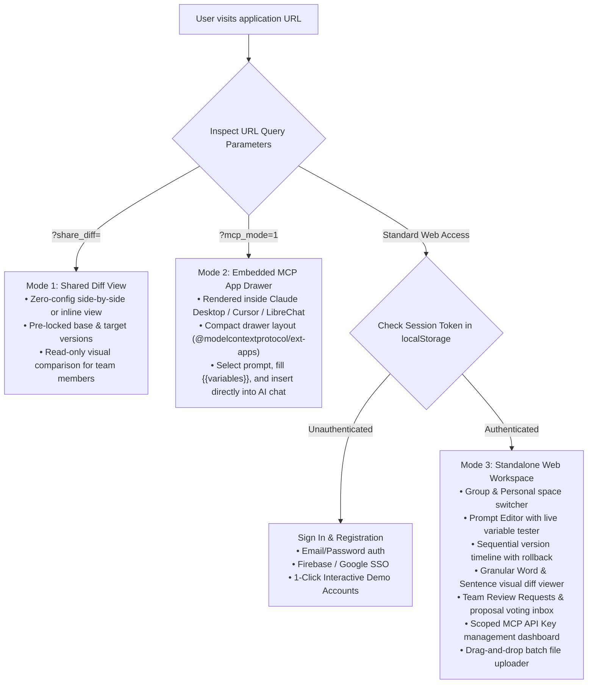

# PromptHold: Full System Architecture & Blueprint

This document provides a comprehensive, at-a-glance architectural blueprint of the entire **PromptHold RBAC & Version Control** platform. It details the client interaction models, edge routing, compute containers, distributed caching, database relations, and automated failover mechanics.

---

## 1. High-Level System Architecture Diagram



---

## 2. Request Routing & Failover Sequence

The Cloudflare Worker implements intelligent load-balancing and instant edge failover to prevent users from experiencing cold-start stalls.



---

## 3. Relational Data Model (Entity-Relationship)

Every database table is strictly isolated by group boundaries and personal ownership.



---

## 4. Role-Based Access Control (RBAC) Permission Matrix

PromptHold enforces a two-tier permission system: Global Workspace tier and Group-Level Membership tier.

| Action / Capability | Workspace Admin | Group Owner (`GROUP_MANAGER`) | Team Member (`MEMBER`) | Guest (`GUEST`) | Personal Space Owner |
|---|:---:|:---:|:---:|:---:|:---:|
| **View Group Prompts & Diffs** | ✅ Yes | ✅ Yes | ✅ Yes | ✅ Yes | ✅ Yes (Own only) |
| **Test & Interpolate Variables** | ✅ Yes | ✅ Yes | ✅ Yes | ✅ Yes | ✅ Yes |
| **Direct Edit & Publish Version** | ✅ Yes | ✅ Yes | ❌ (Creates Proposal) | ❌ No | ✅ Yes (Instant) |
| **Submit Edit Proposal** | ✅ Yes | ✅ Yes | ✅ Yes | ❌ No | N/A (Direct save) |
| **Vote to Approve Proposals** | ✅ Yes | ✅ Yes | ✅ Yes (Not own) | ❌ No | N/A |
| **Switch Active Version (Rollback)** | ✅ Yes | ✅ Yes | ❌ No | ❌ No | ✅ Yes |
| **Batch Upload Files (.txt, .md, .csv)** | ✅ Yes | ✅ Yes | ❌ No | ❌ No | ✅ Yes |
| **Add / Remove Members & Guests** | ✅ Yes | ✅ Yes | ❌ No | ❌ No | N/A |
| **Configure Required Approvals** | ✅ Yes | ✅ Yes | ❌ No | ❌ No | N/A |
| **Create Scoped MCP API Keys** | ✅ Yes | ✅ Yes | ✅ Yes | ✅ Yes (Read-only) | ✅ Yes |
| **Access Other Users' Personal Space** | ❌ Strictly Isolated | ❌ Strictly Isolated | ❌ Strictly Isolated | ❌ Strictly Isolated | ✅ Full Ownership |

---

## 5. Dual-Mode Frontend Operating Architecture

The React application ([`frontend/src/App.tsx`](file:///media/tinux/Media%20&%20Files/Code/Projects/prompt-vault-mcp/frontend/src/App.tsx)) automatically detects its environment and renders in one of three modes:



---

## 6. Project Directory Map

```text
prompt-vault-mcp/
├── ARCHITECTURE.md                  # This complete architecture blueprint
├── DEPLOYMENT_GUIDE.md              # Zero-cost cloud deployment guide
├── MAKING_CHANGES_LIVE.md           # Operational release & update guide
├── AGENTS.md                        # Authoritative system rules for AI agents
├── README.md                        # Project summary & getting started
├── Dockerfile                       # Multi-platform production container definition
├── render.yaml                      # Infrastructure-as-code blueprint for Render
├── Makefile                         # Local and container automation targets
├── run_tests.sh                     # 5-stage automated pre-flight test runner
│
├── backend/                         # Compute & Backend Service (Python/FastAPI)
│   ├── main.py                      # REST API endpoints, routing & CORS
│   ├── models.py                    # SQLAlchemy database ORM models
│   ├── schemas.py                   # Pydantic v2 input/output data schemas
│   ├── permissions.py               # RBAC rules, variable parser & scoping
│   ├── auth.py                      # PBKDF2 password hashing & token verification
│   ├── cache.py                     # Upstash Redis caching & GitHub feedback integration
│   ├── mcp_server.py                # FastMCP server & MCP tools definition
│   ├── seed.py                      # Database schema initial migration & demo data
│   └── tests/                       # Automated backend pytest test suites
│
├── cloudflare-worker/               # Global Edge Gateway & Load Balancer
│   ├── worker.js                    # Reverse proxy, 2.8s timeout, failover SQL & 14m cron
│   ├── wrangler.toml                # Cloudflare Worker configuration & variables
│   └── package.json                 # Worker runtime dependencies (@neondatabase/serverless)
│
└── frontend/                        # Frontend User Interface (React 18 + Vite + Tailwind)
    ├── index.html                   # HTML entry point shell
    ├── vite.config.ts               # Vite bundler configuration & proxies
    └── src/
        ├── App.tsx                  # Main application router & mode selector
        ├── api.ts                   # Type-safe API client & session manager
        ├── types.ts                 # TypeScript interfaces matching backend models
        └── components/              # Modular UI components
            ├── PromptDashboard.tsx          # Main prompt library & space filters
            ├── PromptEditorAndHistory.tsx   # Prompt editor, variable tester & timeline
            ├── VisualDiffViewer.tsx         # Granular word/sentence diff viewer
            ├── ReviewRequestsDashboard.tsx  # Proposal review & approval voting inbox
            ├── AccessGroupManager.tsx       # Team groups & member management
            ├── McpInChatDrawer.tsx          # In-chat MCP App drawer
            ├── SharedDiffPage.tsx           # Standalone shareable diff view
            ├── LoginPage.tsx                # Sign In & Demo accounts
            └── ui/                          # Custom Tailwind modals & popovers
                ├── ErrorBoundary.tsx        # React component crash protection
                ├── RoleBadge.tsx            # Interactive RBAC role pill
                ├── Brand.tsx                # Logos & highlighted prompt tokens
                └── ...                      # Custom dropdowns & confirmation modals
```
